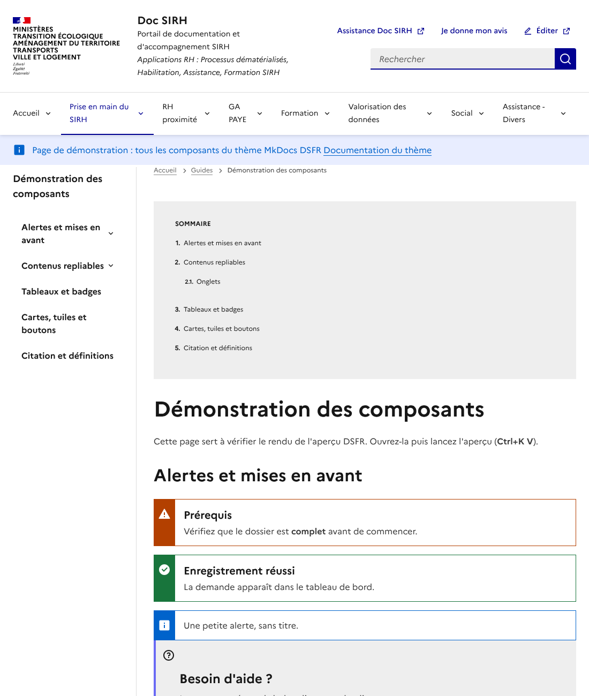
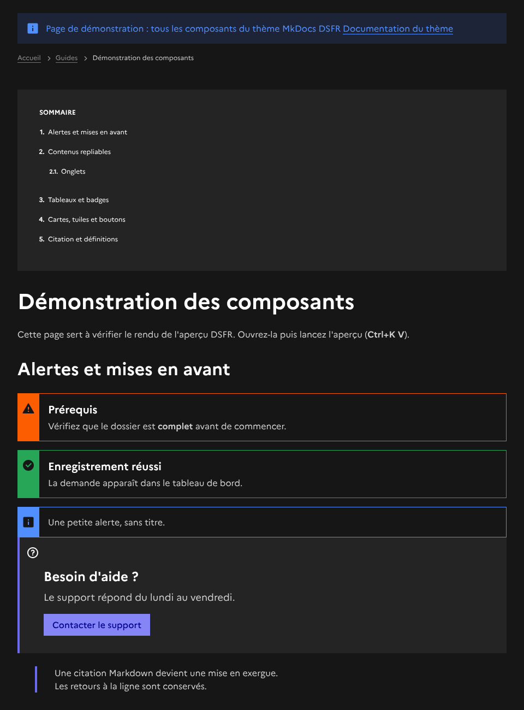
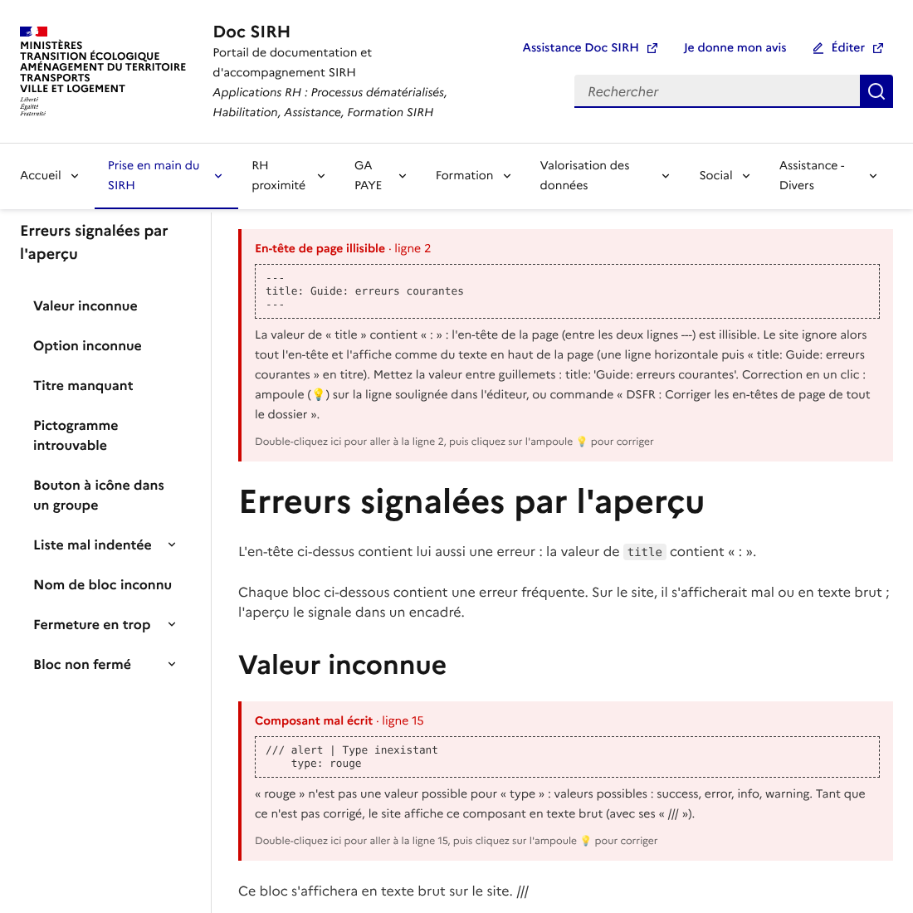
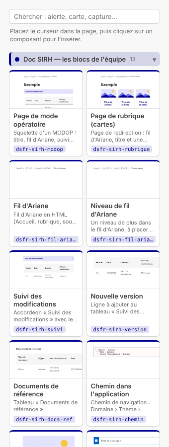

# Aperçu DSFR pour Markdown

[](https://github.com/bastienR17/DSFR-VScode/actions/workflows/ci.yml)


Extension VS Code qui affiche, dans l'aperçu Markdown, **le rendu exact d'une page écrite pour un site
[MkDocs DSFR](https://pub.gitlab-pages.din.developpement-durable.gouv.fr/numeco/mkdocs-dsfr-doc/)** :
alertes, accordéons, cartes, tuiles, onglets, bandeau, fil d'Ariane… avec les styles, polices et icônes
du [Système de Design de l'État](https://www.systeme-de-design.gouv.fr/).

Extension créée par **Bastien** ([@bastienR17](https://github.com/bastienR17)).

| Thème clair | Thème sombre |
|---|---|
|  |  |

> **Usage réservé à l'administration.** Le DSFR et la marque de l'État (dont la police Marianne)
> sont réservés aux sites et services publics ([conditions d'utilisation](https://www.systeme-de-design.gouv.fr/cgu/)).
> Cette extension s'adresse donc aux services qui rédigent une documentation avec le thème MkDocs DSFR,
> et n'est pas publiée sur le Marketplace public de VS Code.
>
> Projet indépendant, non affilié au Service d'information du Gouvernement ni aux mainteneurs du thème mkdocs-dsfr.

## Fonctionnalités

- **Tous les composants du thème** : les 17 blocs de `dsfr_structure` (`/// alert`, `/// accordion`,
  `/// card`, `/// tile`, `/// tabs`, `/// buttons`, `/// tags`, `/// row` / `/// col`…), les citations `>` en
  mise en exergue, les tableaux DSFR avec légende, les encadrés `!!!` et `???`.
- **L'en-tête de page** : bandeau d'information, fil d'Ariane, sommaire et lettre d'information déclarés
  dans le YAML en haut du fichier, placés comme sur le site.
- **Un rendu fidèle au site** : le HTML produit est comparé automatiquement à celui du vrai moteur
  du site (Python-Markdown + `dsfr_structure`), et les 41 exemples de la documentation officielle du thème sont testés.
  L'aperçu reproduit aussi les règles Markdown du site là où elles diffèrent de celles de VS Code.
- **Les erreurs signalées là où on écrit** : option inconnue, valeur invalide, bloc non fermé,
  pictogramme introuvable, liste mal indentée, en-tête YAML illisible, lien ou image introuvable…
  affichés dans l'aperçu **et soulignés dans le Markdown**, avec une correction en un clic quand c'est possible.
- **Autocomplétion et aide au survol** : noms de blocs, options et valeurs proposés pendant la frappe,
  description de chaque option et lien vers la documentation du thème.
- **Interactif** : accordéons, onglets, fil d'Ariane et sommaire cliquables (un lien vers une ancre placée
  dans un accordéon fermé l'ouvre, comme sur le site) ; thème clair ou sombre aligné sur VS Code.
- **La page comme sur le site** : en-tête (bloc-marque, titre du site), menu latéral avec le sommaire de la
  page, colonne de contenu et pied de page, d'après les gabarits du thème. Les textes de l'en-tête, du menu et du
  pied de page sont lus dans le `mkdocs.yml` du site ; sans lui, ce sont ceux de Doc SIRH (bloc-marque des
  ministères, liens « Assistance Doc SIRH » et « Je donne mon avis », rubriques du menu, la rubrique de la page
  étant mise en évidence). En option, la page s'affiche à la largeur d'un ordinateur, réduite pour tenir dans
  l'aperçu : les cartes passent à la ligne au même endroit que sur le site.
- **Les blocs `///` colorés et repliables dans l'éditeur** : nom du bloc, titre, options et fermeture en couleur ;
  une flèche dans la marge replie un bloc (onglets, accordéon, grille…) jusqu'à son `///`.
- **Aperçu à côté du Markdown** en un clic, ou dans une fenêtre séparée à placer sur un second écran.
  L'aperçu suit la page ouverte : changer d'onglet affiche l'autre page, avec ses accordéons tels qu'on les a laissés.
- **42 snippets**, dont 13 propres à Doc SIRH, pour insérer les composants sans retenir leur syntaxe, et un
  bouton **＋ Insérer un composant** qui les présente rangés par familles, avec une phrase d'explication.
- **Une boîte à composants** dans la barre de gauche (icône **DSFR**) : chaque composant avec une miniature de son
  rendu, une recherche, et un clic pour l'insérer dans la page.
- **Pensé pour les rédacteurs non techniciens** : les messages sont en français simple (ce qui ne va pas, et quoi faire) ;
  le bas de l'écran indique « ✓ Page sans erreur » en vert, ou « N points à corriger » en rouge ; l'aperçu s'ouvre
  tout seul et les lignes longues passent à la ligne.





## Installation

1. Télécharger le fichier `.vsix` de la dernière version dans les
   [Releases](https://github.com/bastienR17/DSFR-VScode/releases).
2. Dans VS Code : panneau **Extensions** → menu **⋯** → **Installer à partir d'un VSIX…**
   (ou en ligne de commande : `code --install-extension dsfr-markdown-preview-<version>.vsix`).
3. Recharger la fenêtre : **Ctrl+Maj+P** → **Developer: Reload Window**.

Pour mettre à jour, installer le nouveau `.vsix` de la même façon.

Première utilisation ? Le [guide de prise en main](docs/prise-en-main.md) montre en 5 minutes comment
ouvrir l'aperçu, insérer un composant et corriger une erreur.

## Utilisation

Ouvrir un fichier `.md`, puis cliquer sur le bouton **Ouvrir l'aperçu DSFR** en haut à droite de l'éditeur
(ou **Ctrl+Alt+D**, **Cmd+Maj+Alt+D** sur macOS) : l'écran se partage en deux, **le Markdown à gauche et
l'aperçu à droite**, et le curseur reste dans le Markdown pour continuer à écrire.

| Action | Comment |
|---|---|
| Aperçu à côté (par défaut) | Bouton **Ouvrir l'aperçu DSFR**, **Ctrl+Alt+D**, ou clic droit sur le fichier → **Ouvrir l'aperçu DSFR à côté** |
| Aperçu dans une fenêtre séparée | Clic droit sur le fichier ou son onglet → **Ouvrir l'aperçu DSFR dans une nouvelle fenêtre** |
| Aperçu à la place de l'éditeur | **Ctrl+Maj+V** (commande standard de VS Code) |

Pour que le bouton et **Ctrl+Alt+D** ouvrent plutôt une fenêtre séparée (pratique avec un second écran),
régler `dsfrPreview.openMode` sur `window`. La fenêtre séparée nécessite VS Code 1.85 ou plus récent.

Le rendu se met à jour pendant la saisie, et l'aperçu suit le fichier Markdown actif : en passant d'un
onglet à l'autre, il affiche la page correspondante. Chaque page retrouve l'état de ses accordéons et
onglets. L'indicateur **DSFR** de la barre d'état montre si le rendu est actif ; un clic l'active ou le
désactive pour revenir à l'aperçu standard de VS Code.

### Écrire sans erreur

L'extension analyse la page ouverte (et seulement elle) pendant que vous écrivez :

- **Soulignements** : chaque problème affiché dans l'aperçu est aussi souligné dans le Markdown et listé
  dans le panneau **Problèmes** (**Ctrl+Maj+M**). Rouge : le bloc s'affichera en texte brut sur le site ;
  orange : à corriger ou rendu différent sur le site.
- **Corrections rapides** : ampoule sur la ligne soulignée (ou **Ctrl+.**). Par exemple `type: warnig` →
  `warning`, `open: oui` → `true`, option mal orthographiée renommée, titre ajouté à un accordéon,
  bloc oublié fermé par `///`, classe `fr-btns-group--icon-left` ajoutée à un groupe de boutons.
- **Localiser les problèmes** : le bas de l'écran indique **✓ Page sans erreur** (vert), **N points à vérifier**
  (orange) ou **N points à corriger** (rouge). Un clic (ou clic droit dans le Markdown → **DSFR : Points à
  corriger dans la page**) liste les points avec leur ligne ; en choisir un place le
  curseur dessus. **F8** passe aussi d'un problème au suivant. L'extension ne modifie jamais la page
  d'elle-même : chaque correction de l'ampoule demande un clic.
- **Dans l'aperçu**, chaque encadré d'erreur indique la ligne du fichier ; un double-clic sur l'encadré
  place l'éditeur sur cette ligne. Quand un bloc n'est pas fermé à cause d'un « ``` » en trop, l'encadré
  donne la ligne de ce « ``` » (elle est aussi soulignée dans l'éditeur).
- **Structure** : un nom de bloc inconnu (`/// alrt` → `alert` ?) et un `///` qui ne ferme aucun bloc
  sont signalés : sur le site, ces lignes s'afficheraient telles quelles.
- **Couleurs et repli** : les en-têtes `/// nom | titre`, leurs options et les fermetures `///` sont colorés aux
  couleurs du DSFR (`///` en rouge Marianne, nom du bloc en bleu France, titre en vert, options en violet, léger
  fond bleu sur les lignes d'ouverture et de fermeture), quel que soit le thème de VS Code,
  ce qui montre d'un coup d'œil où commence et finit chaque bloc. La flèche dans la marge (ou **Ctrl+Maj+[**,
  **Cmd+Alt+[** sur Mac) replie un bloc jusqu'à sa fermeture.
- **Autocomplétion** : après `/// `, la liste des blocs ; sur une ligne d'options (4 espaces sous l'en-tête),
  les options du bloc, puis leurs valeurs (types, couleurs, pictogrammes, icônes du DSFR).
- **Survol** d'un nom de bloc ou d'une option : description, valeurs possibles, valeur par défaut et lien
  vers la page du composant dans la documentation du thème.
- **Liens et images** : page `.md`, image, fichier ou ancre `#titre` introuvables. Si le dossier contient
  le `mkdocs.yml` du site, les liens absolus (`/guides/page.md`) sont résolus depuis `docs_dir`, et une
  syntaxe utilisée mais non activée dans `markdown_extensions` (blocs `///`, `!!!`, `???`, `{: … }`) est signalée.
  Les adresses web et les liens vers un dossier ne sont pas vérifiés.
- **Défauts de rédaction** visibles sur le site, fréquents après un copier-coller depuis Word : lien mal
  formé (`[texte(https://…)` sans `]`, ou adresse sans `)` final), astérisques échappés `\*\*texte\*\*`
  affichés au lieu du gras, titre coupé en deux (la fin du titre, en minuscule, passée à la ligne suivante).
  Chacun a sa correction dans l'ampoule. Une ligne de grille `/// row` non fermée avant la suivante est
  signalée avec la ligne exacte où ajouter `///`.
- **Conseils** (soulignés en pointillés bleus, non comptés dans la barre d'état) : lien absolu vers une page du site (`https://docsirh.e2.rie.gouv.fr/Rubrique/Page/`) :
  l'ampoule propose le lien relatif vers le fichier `.md` quand il est trouvé dans le dossier. Les liens
  vers `…/fichiers/` ne sont pas concernés.

### Snippets

Dans un fichier Markdown, taper `dsfr-` : la liste des composants s'ouvre toute seule, sans **Ctrl+Espace**.
Continuer à taper filtre la liste (`dsfr-acc` → accordéon), **Entrée** insère le composant. Les valeurs
possibles (type d'alerte, couleur…) se choisissent ensuite dans une liste ; **Tab** passe au champ suivant.

| Raccourci | Composant |
|---|---|
| `dsfr-entete` | En-tête de page (fil d'Ariane, sommaire), tout en haut du fichier |
| `dsfr-bandeau`, `dsfr-fil-ariane`, `dsfr-sommaire`, `dsfr-lettre-info` | Clés à ajouter dans l'en-tête `---` |
| `dsfr-alerte`, `dsfr-alerte-simple` | Alerte avec ou sans titre |
| `dsfr-accordeon` | Accordéon |
| `dsfr-badge`, `dsfr-badge-couleur` | Badge |
| `dsfr-mise-en-avant` | Mise en avant (callout) |
| `dsfr-citation`, `dsfr-exergue` | Citation, mise en exergue |
| `dsfr-carte`, `dsfr-tuile` | Carte, tuile |
| `dsfr-tuile-2`, `dsfr-tuile-3` | 2 ou 3 tuiles côte à côte (l'une sous l'autre sur mobile) |
| `dsfr-carte-2`, `dsfr-carte-3` | 2 ou 3 cartes côte à côte (l'une sous l'autre sur mobile) |
| `dsfr-grille` | Ligne de grille à deux colonnes |
| `dsfr-onglets` | Système d'onglets |
| `dsfr-boutons`, `dsfr-bouton` | Groupe de boutons, bouton |
| `dsfr-tag`, `dsfr-tags` | Tag (étiquette), groupe de tags |
| `dsfr-image`, `dsfr-video` | Contenu média |
| `dsfr-img` | Image hébergée sur Doc SIRH : insère ``, curseur après `fichiers/` pour compléter le chemin, puis **Tab** pour la description |
| `dsfr-tableau` | Tableau avec légende |

#### Snippets Doc SIRH

Les blocs tels que l'équipe DSNUMRH4 les écrit dans Doc SIRH. Taper `dsfr-sirh` pour n'afficher qu'eux.

| Raccourci | Insère |
|---|---|
| `dsfr-sirh-modop` | Page de mode opératoire complète : titre, fil d'Ariane, suivi des modifications, documents de référence, contexte |
| `dsfr-sirh-rubrique` | Page de rubrique : fil d'Ariane, titre et une ligne de 3 cartes vers les modes opératoires |
| `dsfr-sirh-fil-ariane` | Fil d'Ariane en HTML (Accueil, rubrique, sous-rubrique, page courante) |
| `dsfr-sirh-fil-ariane-niveau` | Un niveau de plus dans le fil d'Ariane |
| `dsfr-sirh-suivi` | Accordéon « Suivi des modifications » avec son tableau |
| `dsfr-sirh-version` | Nouvelle ligne du suivi des modifications, datée du jour automatiquement |
| `dsfr-sirh-docs-ref` | Tableau « Documents de référence » |
| `dsfr-sirh-chemin` | Chemin dans l'application : `⮡ Domaine` › `⮡ Thème` › `⮡ Action fonctionnelle` |
| `dsfr-sirh-capture` | Capture d'écran hébergée dans `fichiers/`, avec sa description et sa largeur |
| `dsfr-sirh-consigne` | Encadré de consigne : alerte sans titre, texte en italique |
| `dsfr-sirh-cartes-3` | Ligne de 3 cartes (l'image n'est saisie qu'une fois pour les trois) |
| `dsfr-sirh-carte` | Une carte à ajouter dans une ligne |
| `dsfr-sirh-carte-fichier` | Carte vers un fichier (Excel, PDF…) avec sa date de version |

Sur Mac, **Ctrl+Espace** sert par défaut à changer la langue du clavier : inutile ici, la frappe de
`dsfr-` suffit.

## Syntaxe en bref

Un bloc commence par `/// nom | titre`, ses options sont indentées de **4 espaces** juste en dessous,
et il se ferme par `///` :

```markdown
/// alert | Prérequis
    type: warning
Vérifiez que le dossier est **complet**.
///
```

Les composants uniques par page se déclarent dans l'en-tête YAML :

```markdown
---
notice:
  type: warning
  description: "Texte du bandeau : entre guillemets s'il contient « : »"
breadcrumb:
  - Accueil: /
  - Guides: /guides/
  - Titre de la page courante
summary: true
---
```

La syntaxe complète et toutes les options sont décrites dans la
[documentation du thème MkDocs DSFR](https://pub.gitlab-pages.din.developpement-durable.gouv.fr/numeco/mkdocs-dsfr-doc/).
Le dossier [`samples/`](samples/) contient une page de démonstration de tous les composants et une page d'erreurs courantes.

## Fidélité au site

Le site est généré par MkDocs avec **Python-Markdown**, alors que l'aperçu de VS Code utilise **markdown-it**.
Là où les deux moteurs diffèrent, l'aperçu reproduit le comportement du site (réglage `dsfrPreview.mkdocsCompat`) :

- une liste collée à un paragraphe, sans ligne vide, reste du texte ;
- un `\` en fin de ligne reste affiché et ne crée pas de retour à la ligne ;
- `###Titre` sans espace après les `#` est un titre sur le site (pas dans VS Code ni le wiki GitLab) : l'aperçu
  l'affiche comme le site, et l'éditeur propose d'ajouter l'espace (`### Titre`, lu de la même façon partout) ;
- `**texte **suite` (espace avant les `**` fermantes) est signalé : selon la version de Python-Markdown du site,
  il est en gras (jusqu'à 3.11.0) ou affiché avec les `**` (3.11.1 et après). Écrire `**texte** suite` ;
- une sous-liste indentée de moins de 4 espaces n'est pas imbriquée : ses puces rejoignent la liste principale,
  comme sur le site (signalé, avec une correction qui l'indente de 4 espaces) ;
- un autre contenu de liste indenté de moins de 4 espaces est signalé (sur le site, il sort de la liste) ;
- les attributs `{: .classe }` (`attr_list`) et les listes de définitions (`def_list`) sont pris en charge.

L'aperçu signale aussi deux particularités du thème : le titre `title` du bandeau d'en-tête n'est pas
affiché par mkdocs-dsfr (encore en 0.27.0), et un bouton à icône placé dans un groupe `/// buttons` est réduit à son
icône si le groupe n'a pas la classe `fr-btns-group--icon-left` ou `--icon-right`.

## En-têtes YAML illisibles

Erreur fréquente dans les en-têtes générés automatiquement : une valeur qui contient elle-même « : ».

```markdown
---
title: mentor: Déposer les documents      ← illisible
---
```

MkDocs ne signale rien : il ignore tout l'en-tête et l'affiche comme du texte en haut de la page
(une ligne horizontale puis « title: mentor: … » en titre), et les métadonnées sont perdues.
L'extension souligne la ligne fautive dans l'éditeur et l'explique dans l'aperçu. Pour corriger :

- **un fichier** : ampoule sur la ligne soulignée (ou **Ctrl+.**) → *Mettre entre guillemets les valeurs qui contiennent « : »* ;
- **tout le dossier** : palette de commandes (**Ctrl+Maj+P**) → **DSFR : Corriger les en-têtes de page de tout le dossier**.
  La liste des fichiers concernés est affichée avant toute modification.

Résultat : `title: 'mentor: Déposer les documents'`. Si les en-têtes sont produits par un script,
le mieux est de corriger aussi ce script pour qu'il mette les valeurs entre guillemets.

## Réglages

| Réglage | Valeurs | Par défaut | Rôle |
|---|---|---|---|
| `dsfrPreview.enabled` | `true`, `false` | `true` | Appliquer le rendu DSFR |
| `dsfrPreview.theme` | `auto`, `light`, `dark` | `auto` | Thème DSFR (`auto` suit VS Code) |
| `dsfrPreview.showErrors` | `true`, `false` | `true` | Afficher les encadrés d'erreur dans l'aperçu et souligner les problèmes dans l'éditeur |
| `dsfrPreview.checkLinks` | `true`, `false` | `true` | Souligner les liens, images et ancres introuvables, et les syntaxes non activées dans le `mkdocs.yml` |
| `dsfrPreview.checkImageAlt` | `true`, `false` | `false` | Signaler les images sans description (conseil d'accessibilité, coupé par défaut) |
| `dsfrPreview.siteUrl` | adresse | `https://docsirh.e2.rie.gouv.fr` | Adresse du site, pour signaler les liens absolus vers ses pages (le `site_url` du `mkdocs.yml` est prioritaire ; réglage vide : pas de vérification) |
| `dsfrPreview.mkdocsCompat` | `true`, `false` | `true` | Reproduire les règles Markdown du site |
| `dsfrPreview.autoOpen` | `true`, `false` | `true` | Ouvrir l'aperçu à côté automatiquement à la première page Markdown ouverte |
| `dsfrPreview.colors` | `true`, `false` | `true` | Couleurs DSFR des blocs `///` dans l'éditeur (rouge Marianne, bleu France, vert, violet) |
| `dsfrPreview.openMode` | `side`, `window` | `side` | Où s'ouvre l'aperçu : à côté du Markdown ou dans une fenêtre séparée |
| `dsfrPreview.pageLayout` | `site`, `content` | `site` | Page entière comme sur le site (en-tête, menu latéral, pied de page), ou contenu seul |
| `dsfrPreview.desktopWidth` | `true`, `false` | `false` | Page à la largeur d'un ordinateur (1280 px), réduite pour tenir dans l'aperçu |
| `dsfrPreview.siteBrand`, `siteTitle`, `siteTagline` | texte | ceux de Doc SIRH | Bloc-marque, titre et sous-titre de l'en-tête, si le `mkdocs.yml` du site n'est pas trouvé |

## Limites connues

- L'en-tête et le pied de page reprennent le gabarit du thème, mais pas le menu de navigation du site (les autres
  pages), la recherche ni les liens « page précédente / suivante » : l'aperçu ne connaît que la page ouverte.
- Le JavaScript officiel du DSFR n'est pas chargé : accordéons, onglets et sommaire sont reproduits par un petit script.
- Les chemins d'images sont résolus par rapport au fichier `.md`, comme le fait VS Code.
- Les pictogrammes des tuiles sont intégrés en SVG : le rendu est identique, le HTML diffère légèrement du site.
- Version de référence : thème mkdocs-dsfr 0.27.0, `dsfr_structure` 0.13, DSFR 1.15.4.

## Contribuer

Le fonctionnement interne, les tests et la procédure de publication sont décrits dans
[CONTRIBUTING.md](CONTRIBUTING.md). En bref :

```bash
npm install
pip install -r requirements-dev.txt
npm test
```

Puis **F5** dans VS Code pour lancer l'extension sur les pages d'exemple.

## Auteur et licence

Extension conçue et développée par **Bastien** ([@bastienR17](https://github.com/bastienR17)).

Code du projet © 2026 Bastien (bastienR17), sous [licence MIT](LICENSE). Les fichiers du DSFR, du thème
mkdocs-dsfr et des bibliothèques incluses gardent leur propre licence : voir [THIRD_PARTY_NOTICES.md](THIRD_PARTY_NOTICES.md).
